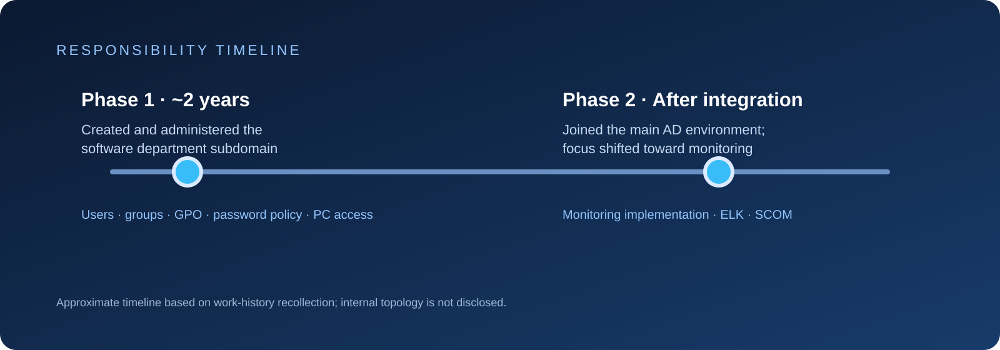
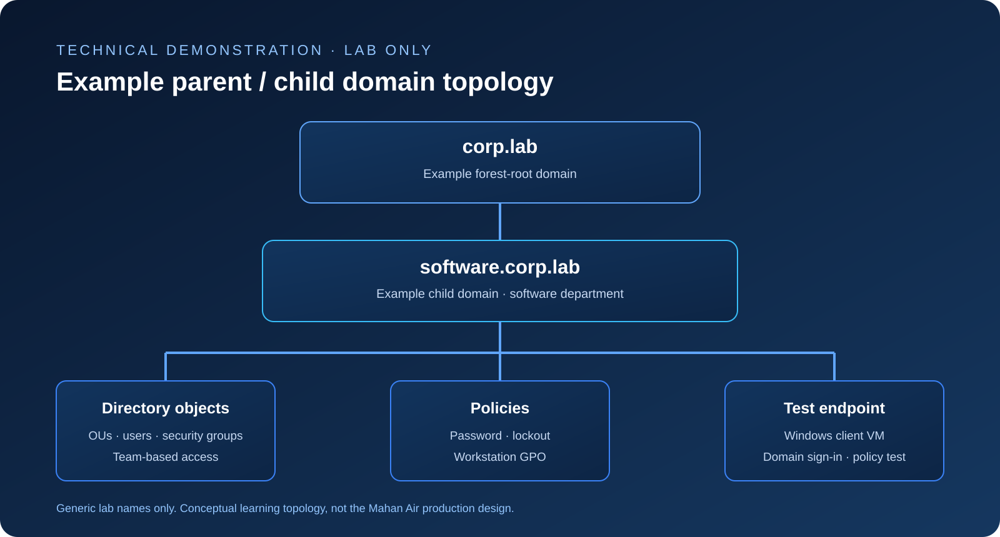

> **Confidentiality note:** This case study describes my responsibilities at a high level. Company domain names, hostnames, IP addresses, user information, screenshots, and sensitive infrastructure details are intentionally excluded. The diagrams are illustrative, not copies of the production environment.

## Overview

From April 2013 to September 2019, I worked as a Systems Administrator at Mahan Air. During the earlier part of this role, I worked with a colleague to establish a separate Active Directory subdomain for the software department. I administered that subdomain for approximately two years and managed the department's user access, groups, policies, workstations, and supporting systems.

After the subdomain was integrated into the main Active Directory environment, my responsibilities shifted more toward infrastructure operations and monitoring implementation, including work with ELK Stack and SCOM.

This experience gave me practical exposure to enterprise identity administration and the day-to-day relationship between directory services, endpoint access, Windows systems, virtualization, and monitoring.

## Production Experience

<figure>
  
  <figcaption><em>High-level timeline. The diagrams are illustrative and do not expose the original production topology.</em></figcaption>
</figure>

### 1. Active Directory subdomain creation and administration

I worked with a colleague to create a dedicated Active Directory subdomain for the software department. I then took responsibility for administering that subdomain for approximately two years.

My responsibilities included:

- Creating and managing user accounts for department employees.
- Creating security groups and organizing users according to teams and access requirements.
- Managing access to department computers and relevant internal resources.
- Creating and maintaining Group Policy settings for the department.
- Configuring password-related policies and account access settings.
- Supporting authentication and access issues for users and workstations.

The goal was to provide a manageable identity and access structure for the software department while keeping its users, teams, and workstation permissions organized.

### 2. Workstation, Windows, and virtualization operations

Alongside directory administration, I managed the department's PCs and supporting IT systems. The environment included Windows systems and a VMware virtual machine environment that grew to approximately six VMs.

My work included day-to-day administration and support of department workstations, Windows systems, and the virtualized infrastructure. This connected identity administration with the practical operation of the systems employees used.

### 3. Integration and transition to monitoring

After approximately two years, the separate subdomain was integrated into the main Active Directory environment. Following that transition, my focus shifted more toward infrastructure monitoring and operations.

I worked on monitoring implementation and operational visibility using:

- **ELK Stack:** for centralized log collection and investigation.
- **SCOM:** for infrastructure and system monitoring.

This transition broadened my role from administering a department-level directory environment toward monitoring and supporting a more integrated infrastructure environment.

### Production experience summary

| Area | Responsibilities |
|---|---|
| Active Directory | Helped create a dedicated software department subdomain and administered it for approximately two years |
| Identity lifecycle | Created and managed user accounts and security groups |
| Access management | Organized team-based access and permissions to department computers and resources |
| Group Policy | Configured and maintained Group Policy and password-related settings |
| Endpoint operations | Managed department PCs and Windows systems |
| Virtualization | Managed a VMware environment with up to approximately six virtual machines |
| Monitoring | Shifted toward monitoring implementation and operations after integration, using ELK Stack and SCOM |

## Technical Demonstration

**Illustrative lab blueprint — separate from production experience**

This section defines a reproducible lab scenario to demonstrate the Active Directory concepts behind the production work. It is a learning environment design, not a claim that these exact lab steps or commands were used at Mahan Air.

### Lab objective

Build a small, isolated Windows Server lab that demonstrates how a parent domain and a software department child domain can be structured, how users and groups can be organized, and how Group Policy and workstation access can be validated.

### Example lab architecture

The names below are reserved example names for a private lab. They are not the original company domain names.

| Component | Example lab role |
|---|---|
| corp.lab | Example forest-root domain |
| software.corp.lab | Example child domain for a software department |
| Windows Server VM | Domain controller for the lab domain |
| Windows 11 client VM | Domain-joined workstation used for access tests |
| Active Directory Users and Computers | User, group, and OU administration |
| Group Policy Management | Password, account, and workstation policy configuration |

### Demonstration tasks

1. **Build the domain structure:** Create an isolated example forest and a child domain for the software department.
2. **Organize directory objects:** Create OUs for teams, users, groups, and workstations.
3. **Create role-based groups:** Define security groups for example teams such as Developers and Operations.
4. **Create test users:** Add non-production test accounts and assign them to the appropriate groups.
5. **Configure policies:** Demonstrate domain password and account-lockout settings, plus workstation policies linked to the appropriate OU.
6. **Join a client:** Join a Windows client to the example child domain and validate domain sign-in.
7. **Test access:** Confirm that group membership and policy scope produce the intended access behavior.
8. **Document integration concepts:** Explain the trust and directory-integration considerations involved when a child domain later becomes part of a consolidated directory environment.

### Example PowerShell commands

The following examples are for a lab domain only. They require the Active Directory PowerShell module and suitable administrative privileges. Replace the distinguished names and example values to match the lab you build.

Create a team OU:

~~~powershell
New-ADOrganizationalUnit -Name "Software" -Path "DC=software,DC=corp,DC=lab"
~~~

Create a security group:

~~~powershell
New-ADGroup -Name "Software-Developers" -GroupScope Global -GroupCategory Security -Path "OU=Software,DC=software,DC=corp,DC=lab"
~~~

Create a lab user with a securely prompted password:

~~~powershell
$password = Read-Host "Enter a lab-only password" -AsSecureString
New-ADUser -Name "Alex Developer" -SamAccountName "alex.dev" -UserPrincipalName "alex.dev@software.corp.lab" -Path "OU=Software,DC=software,DC=corp,DC=lab" -AccountPassword $password -Enabled $true
~~~

Add the lab user to the team group:

~~~powershell
Add-ADGroupMember -Identity "Software-Developers" -Members "alex.dev"
~~~

### Validation checklist

- [ ] The child domain is reachable and its DNS configuration resolves correctly.
- [ ] Test users and security groups exist in the intended OUs.
- [ ] A lab workstation can join the child domain.
- [ ] A test user can sign in to the domain-joined workstation.
- [ ] Group membership is reflected in the user's access token after a new sign-in.
- [ ] Group Policy results show the expected policies for the test user or computer.
- [ ] Password and account-lockout settings behave as configured.
- [ ] The lab documentation distinguishes domain-level password policy from OU-linked workstation and user policies.

### Production experience vs. lab demonstration

| Topic | Production experience | Technical demonstration |
|---|---|---|
| Domain structure | Helped create and administer the department subdomain | Recreates a generic parent/child domain structure |
| Users and groups | Managed real department accounts and team groups | Uses disposable lab accounts and security groups |
| Policies | Managed Group Policy and password-related settings | Demonstrates policy scope and validation |
| Endpoints | Managed department PCs and Windows systems | Uses an isolated Windows client VM |
| Virtualization | Supported a VMware environment of up to approximately six VMs | Uses a small local or virtualized lab |
| Evidence | Work-history description only; no confidential production screenshots | Lab screenshots and command output can be added after the lab is built and tested |

## Skills Demonstrated

- Active Directory subdomain administration
- User and security group management
- Group Policy and password policy administration
- Team-based access management
- Windows Server and workstation administration
- VMware virtual machine operations
- Infrastructure monitoring with ELK Stack and SCOM
- PowerShell fundamentals for directory administration

## What This Experience Taught Me

Enterprise identity management is closely connected to endpoint operations and infrastructure reliability. A well-organized directory structure, clearly defined security groups, and appropriately scoped policies make it easier to manage access consistently as teams and systems evolve.

The transition from a department subdomain to the main Active Directory environment also highlighted the importance of planning identity integration and maintaining operational visibility during infrastructure changes.
