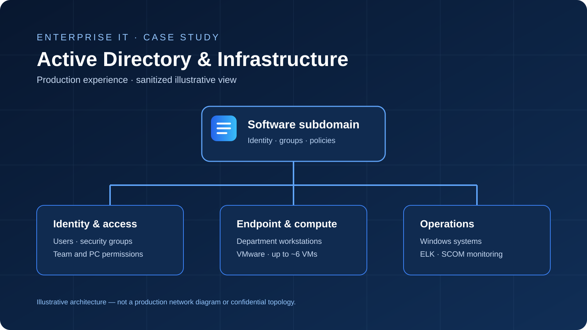
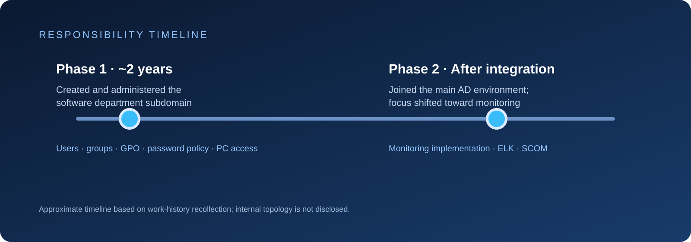
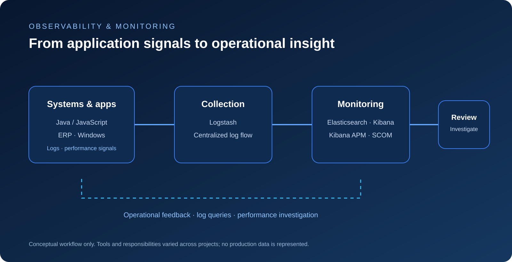
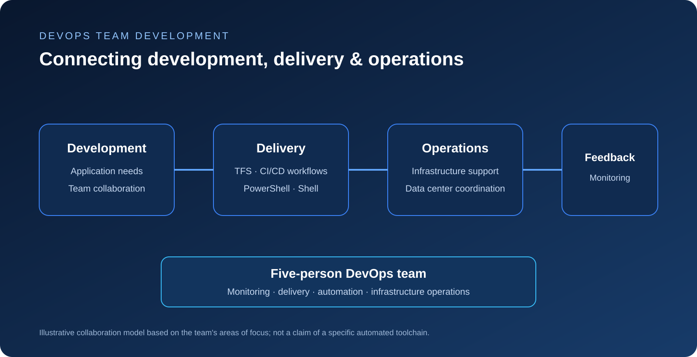
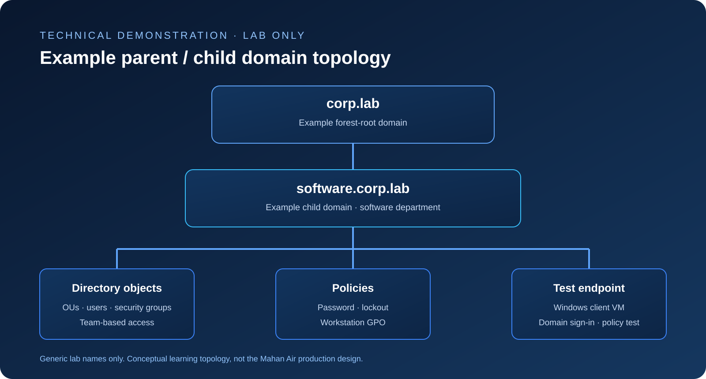

> **Confidentiality note:** This case study describes my responsibilities and collaborative work at a high level. Company domain names, hostnames, IP addresses, user information, screenshots, and sensitive infrastructure details are intentionally excluded. All diagrams are illustrative, not copies of the production environment.

**Organization:** Mahan Air  
**Period:** April 2013 – September 2019  
**Official role:** Systems Administrator

## 01 · Enterprise Infrastructure & Active Directory

<figure>
  
  <figcaption><em>Illustrative overview of the areas I supported; not a production network diagram.</em></figcaption>
</figure>

During the earlier part of my role, I worked with a colleague to establish a separate Active Directory subdomain for the software department. I then took responsibility for administering that subdomain for approximately two years.

My responsibilities included:

- Creating and managing user accounts for department employees.
- Creating security groups and organizing users according to teams and access requirements.
- Managing access to department computers and relevant internal resources.
- Creating and maintaining Group Policy settings for the department.
- Configuring password-related policies and account access settings.
- Supporting authentication and access issues for users and workstations.

Alongside directory administration, I managed the department's PCs and supporting IT systems. The environment included Windows systems and a VMware virtual machine environment that grew to approximately six VMs.

<figure>
  
  <figcaption><em>Approximate progression of responsibilities during the Mahan Air role.</em></figcaption>
</figure>

After approximately two years, the separate subdomain was integrated into the main Active Directory environment. Following that transition, my focus shifted more toward infrastructure monitoring and operations.

## 02 · Observability & Infrastructure Monitoring

<figure>
  
  <figcaption><em>Illustrative monitoring workflow based on the technologies used; no production endpoints or data are shown.</em></figcaption>
</figure>

I worked with a colleague to monitor Java and JavaScript applications, including ERP-related applications, using Elasticsearch, Logstash, Kibana, and Kibana APM.

My work included exploring application logs, preparing queries, and reviewing performance-related information to support investigations.

For Microsoft-based projects, I collaborated with a colleague on a SCOM implementation over approximately six months. After implementation, we handed the solution over to the data center team.

### ERP performance investigation: increased request volume

**Problem:** Request volume increased significantly for an ERP application running on Apache Tomcat. The team needed to accommodate greater concurrency while considering application and server resource limits.

**Investigation:** I used Elasticsearch and Kibana to review application logs and performance-related information. Our QA team used Apache JMeter to simulate concurrent requests and test application behavior under load.

**Team response:** The team increased Tomcat's `maxThreads` setting and adjusted JVM heap settings to accommodate the workload.

**My contribution and learning:** My contribution was monitoring application logs and performance-related information through Elasticsearch and Kibana as part of the team's investigation. The Tomcat and JVM configuration changes were a team effort.

This experience reinforced the importance of investigating application behavior and resource constraints rather than treating a higher thread limit as a guaranteed performance fix. No quantified improvement is claimed because a measured result has not been established.

## 03 · DevOps Team Development, CI/CD & Automation

<figure>
  
  <figcaption><em>Conceptual view of the development, delivery, and operations responsibilities I helped bring together.</em></figcaption>
</figure>

As the work evolved, I helped form and organize a five-person DevOps team focused on connecting development and infrastructure operations.

The team's areas of focus included:

- Application monitoring and observability.
- CI/CD and application deployment workflows using Team Foundation Server (TFS).
- PowerShell and shell scripting for administrative automation and repetitive operational tasks.
- Infrastructure and systems operations.
- Supporting development teams with deployments.

I also served as a technical contact point between software developers and the data center, coordinating application requirements with infrastructure operations.

This expanded my responsibilities from individual systems administration and application support to helping organize a team across delivery, monitoring, automation, and operations.

## 04 · Technical Demonstration

**Illustrative lab blueprint — separate from production experience**

This section describes a reproducible lab scenario to demonstrate the Active Directory concepts behind the production work. It is a learning environment design, not a claim that these exact lab steps or commands were used at Mahan Air.

### Lab objective

Build a small, isolated Windows Server lab that demonstrates how a parent domain and a software department child domain can be structured, how users and groups can be organized, and how Group Policy and workstation access can be validated.

<figure>
  
  <figcaption><em>Generic lab topology only. These domain names are examples and are not Mahan Air production names.</em></figcaption>
</figure>

| Component | Example lab role |
|---|---|
| `corp.lab` | Example forest-root domain |
| `software.corp.lab` | Example child domain for a software department |
| Windows Server VM | Domain controller for the lab domain |
| Windows 11 client VM | Domain-joined workstation used for access tests |
| Active Directory Users and Computers | User, group, and OU administration |
| Group Policy Management | Password, account, and workstation policy configuration |

### Demonstration tasks

1. **Build the domain structure:** Create an isolated example forest and a child domain for the software department.
2. **Organize directory objects:** Create OUs for teams, users, groups, and workstations.
3. **Create role-based groups:** Define security groups for example teams such as Developers and Operations.
4. **Create test users:** Add non-production test accounts and assign them to the appropriate groups.
5. **Configure policies:** Demonstrate domain password and account-lockout settings, plus workstation policies linked to the appropriate OU.
6. **Join a client:** Join a Windows client to the example child domain and validate domain sign-in.
7. **Test access:** Confirm that group membership and policy scope produce the intended access behavior.
8. **Document integration concepts:** Explain the trust and directory-integration considerations involved when a child domain later becomes part of a consolidated directory environment.

### Example PowerShell commands

The following examples are for a lab domain only. They require the Active Directory PowerShell module and suitable administrative privileges. Replace the distinguished names and example values to match the lab you build.

Create a team OU:

~~~powershell
New-ADOrganizationalUnit -Name "Software" -Path "DC=software,DC=corp,DC=lab"
~~~

Create a security group:

~~~powershell
New-ADGroup -Name "Software-Developers" -GroupScope Global -GroupCategory Security -Path "OU=Software,DC=software,DC=corp,DC=lab"
~~~

Create a lab user with a securely prompted password:

~~~powershell
$password = Read-Host "Enter a lab-only password" -AsSecureString
New-ADUser -Name "Alex Developer" -SamAccountName "alex.dev" -UserPrincipalName "alex.dev@software.corp.lab" -Path "OU=Software,DC=software,DC=corp,DC=lab" -AccountPassword $password -Enabled $true
~~~

Add the lab user to the team group:

~~~powershell
Add-ADGroupMember -Identity "Software-Developers" -Members "alex.dev"
~~~

### Validation checklist

- [ ] The child domain is reachable and its DNS configuration resolves correctly.
- [ ] Test users and security groups exist in the intended OUs.
- [ ] A lab workstation can join the child domain.
- [ ] A test user can sign in to the domain-joined workstation.
- [ ] Group membership is reflected in the user's access token after a new sign-in.
- [ ] Group Policy results show the expected policies for the test user or computer.
- [ ] Password and account-lockout settings behave as configured.
- [ ] The lab documentation distinguishes domain-level password policy from OU-linked workstation and user policies.

### Production experience vs. lab demonstration

| Topic | Production experience | Technical demonstration |
|---|---|---|
| Domain structure | Helped create and administered the department subdomain | Recreates a generic parent/child domain structure |
| Users and groups | Managed real department accounts and team groups | Uses disposable lab accounts and security groups |
| Policies | Managed Group Policy and password-related settings | Demonstrates policy scope and validation |
| Endpoints | Managed department PCs and Windows systems | Uses an isolated Windows client VM |
| Virtualization | Supported a VMware environment of up to approximately six VMs | Uses a small local or virtualized lab |
| Evidence | Work-history description only; no confidential production screenshots | Lab screenshots and command output can be added after the lab is built and tested |

## Engineering Capabilities

- **Enterprise identity and access:** Active Directory subdomain administration, user and security group management, Group Policy, and team-based access.
- **Infrastructure operations:** Windows Server, workstation support, VMware vSphere and ESXi.
- **Observability and investigation:** Elasticsearch, Logstash, Kibana, Kibana APM, and SCOM.
- **Application performance awareness:** Reviewing logs and performance information during a team investigation of increased request volume.
- **Delivery and automation:** TFS-based CI/CD workflows, PowerShell, and shell scripting.
- **Cross-team collaboration:** Coordinating development and data center teams and helping organize a five-person DevOps team.

*This case study describes my responsibilities and collaborative work. The environment predates my later cloud-native work and is not presented as Kubernetes or AWS experience.*
